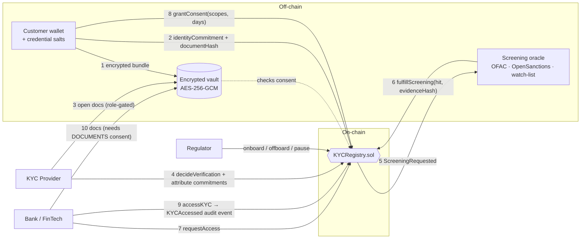

# dKYC Registry — Decentralized KYC / Digital Identity Sharing Registry

> **Problem Statement 3** · FinTech Blockchain Problem Statements Workbook (Oct 2026)
> *Repeated KYC processes create high costs for financial institutions and poor customer experience.*
> **Solution:** a reusable, privacy-preserving on-chain identity credential system that banks can query **with user consent**.

**KYC once → reuse everywhere → only with consent → every access audited.**

A customer completes KYC once with an accredited **KYC provider**. Any other regulated **bank / FinTech** can then rely on that verification — instead of repeating it — but only after the customer grants scoped, time-bound, revocable consent on-chain. A **sanctions / PEP screening oracle** keeps every record continuously checked against live watch-lists, and a **regulator** governs who may participate.

No personal data ever touches the blockchain: the chain stores only salted hashes (commitments), consent decisions and audit events.

---

## 1. What's in the box

| Layer | What it does | Where |
|---|---|---|
| **Smart contract** | Roles, identity commitments, verification, scoped consent, selective disclosure, oracle screening, audit events, pause | `src/KYCRegistry.sol` |
| **Chainlink Functions adapter** | Decentralised screening path for testnets (DON → vault → OpenSanctions → registry) | `src/chainlink/KYCScreeningFunctions.sol`, `chainlink/screening-source.js` |
| **Encrypted document vault** | AES-256-GCM per-document keys; releases files **only if the chain says** the requester has consent | `server/vault.js` |
| **Screening oracle node** | Watches `ScreeningRequested`, screens **live OFAC SDN** / OpenSanctions / demo watch-list, writes result + evidence hash; perpetual re-screening | `server/oracle.js`, `server/screening.js` |
| **API server** | Hosts the dApp, vault API (wallet-signature auth), RPC proxy, oracle status | `server/index.js` |
| **dApp** | Customer · KYC Provider · Bank/FinTech · Regulator dashboards | `frontend/` |
| **Tests** | 51 Foundry tests (incl. fuzz) + 6 screening-engine unit tests + scripted end-to-end demo | `test/`, `server/screening.test.js`, `scripts/demo.js` |

Zero npm dependencies: `ethers` v6 is vendored (`vendor/`, `frontend/ethers.umd.min.js`), Solidity libraries are vendored in `lib/`. You need only **Node.js ≥ 18** and **Foundry**.

---

## 2. Architecture



### When is a KYC "valid"?

```
isKYCValid = status == Verified  AND  now < expiresAt  AND  screening == Clear
```

A provider's approval alone is **not** enough — the oracle must also return a clear sanctions/PEP result. A later hit (perpetual KYC) invalidates the record for every institution instantly.

### Consent scopes (bitmask)

| Bit | Scope | Grants |
|---|---|---|
| 1 | `STATUS` | status, tier, expiry, verifier; identity-commitment match |
| 2 | `RISK` | risk rating, screening result & time; may trigger re-screening |
| 4 | `ATTRIBUTES` | verify selectively disclosed attributes (e.g. `AGE_OVER_18`) |
| 8 | `DOCUMENTS` | download the encrypted document bundle from the vault |

### Privacy design

* **Identity commitment** `keccak256(abi.encode(owner, NAME, dob, idNumber, salt))` — binds the record to the documents without revealing them; the owner address is included so commitments cannot be replayed by someone else.
* **Document hash** `sha256(ciphertext)` — anchors the vault file; any tampering is detected by provider, bank and oracle.
* **Selective disclosure** — per-attribute commitments `keccak256(abi.encode(owner, key, value, salt))`. The customer hands a bank `{attribute, value, salt}`; the bank calls `verifyAttribute` and learns *only that fact* (e.g. over-18, not the birth date).
* **Consent-gated vault** — the vault server never decides access itself; it asks the contract (`hasConsent(owner, requester, DOCUMENTS)`). Requests are authenticated by a fresh (≤ 5 min) wallet signature.
* **Screening evidence** — the full report stays off-chain; only its hash goes on-chain for auditors.

---

## 3. Quick start (local, ~5 minutes)

### Prerequisites

* **Node.js 18+** — `node -v`
* **Foundry** (forge + anvil):
  ```bash
  curl -L https://foundry.paradigm.xyz | bash
  foundryup
  ```
  Windows: use **WSL** (recommended) or Git Bash.

### Run it — three terminals

```bash
# Terminal 1 — local blockchain
anvil

# Terminal 2 — compile, deploy, onboard demo organisations
npm run deploy

# Terminal 2 — API server + vault + oracle + dApp
npm start
```

Open **http://localhost:3000**. Use the **"Acting as"** selector (top right) to switch between the demo actors — each tab also switches to a matching account automatically.

| Dev account | Actor |
|---|---|
| #0 | Regulator (admin) |
| #1 | TrustVerify KYC Services (provider) |
| #2 | Bank Alpha (institution) |
| #3 | NeoPay FinTech (institution) |
| #4 / #5 / #6 | Customers Aarav / Meera / Viktor |
| #9 | Sanctions Screening Oracle (used by the server) |

These are the public Anvil test keys — **never** use them on a real network.

### Automated end-to-end run

```bash
npm run demo      # 11-step scripted scenario with assertions (needs anvil + npm start running)
npm test          # 29 contract tests + 6 screening tests
npm run test:gas  # gas report
```

Restarted Anvil? Run `npm run reset && npm run deploy` (clears local vault/report files that refer to the old chain).

### Using MetaMask instead of demo keys (optional)

Add network *Localhost 8545* (RPC `http://127.0.0.1:8545`, chain ID `31337`), import one of Anvil's printed private keys, then choose **"Connect MetaMask"** in the account selector.

---

## 4. Demo script (for your presentation, ~6 min)

1. **Customer tab** (Aarav) → *Fill sample: clean customer* → attach any image as ID scan → **Encrypt, upload & register**. Point out: only two hashes went on-chain.
2. **KYC Provider tab** → **Review** → show the decrypted profile, the document, and the green *automated checks* (hashes recomputed vs. chain). Run the *pre-check*, then **Approve**.
3. Watch the status flip to *Screening pending* → *Clear* within ~2 s: the oracle screened live lists and wrote the result on-chain.
4. **Bank / FinTech tab** (Bank Alpha) → pick Aarav → **Run KYC check** → denied (*no consent*). **Send request**.
5. **Customer tab** → *Access requests* → **Approve 30d**. Click **Share proof** on `AGE_OVER_18`.
6. **Bank tab** → **Run KYC check** → *KYC VALID — reuse approved*. Paste the proof → *Proof valid* (bank learnt "over 18", not the DOB). Try **Open documents** → denied without `DOCUMENTS` scope.
7. **Customer tab** (switch to Viktor) → *Fill sample: watch-listed name* → register; approve as provider → oracle returns **HIT** → KYC invalid everywhere, risk forced to High.
8. **Regulator tab** → statistics, live OFAC/oracle status, the screening evidence report, and the immutable **global audit trail**. Show **Emergency pause**.
9. **Customer tab** → *Who accessed my data* and **Revoke** consent → bank is blocked again.

---

## 5. Real-time / external data integration

| Source | How it is used | Config |
|---|---|---|
| **US Treasury OFAC SDN list** (live) | Downloaded on start, cached, refreshed every 24 h; individual entries fuzzy-matched (Jaro-Winkler, order-insensitive, DOB-aware) | `SCREENING_SOURCES=local,ofac` (default) |
| **OpenSanctions `/match` API** (live; sanctions **+ PEPs**) | Queried per screening when an API key is set | `OPENSANCTIONS_API_KEY=…`, add `opensanctions` to `SCREENING_SOURCES` |
| **Demo watch-list** (`data/watchlist.json`, fictional names) | Deterministic hits for demos/tests | always available |
| **Chainlink Functions** | Production path: `KYCScreeningFunctions` (holds `ORACLE_ROLE`) sends the request to the DON, which runs `chainlink/screening-source.js` (vault → OpenSanctions) and calls `fulfillScreening` | see §8 |
| **Perpetual KYC** | Oracle re-screens all valid customers every `RESCREEN_INTERVAL_MIN` minutes | default 30 |

Screening is **fail-closed**: if no source can be checked, the oracle retries instead of reporting "clear".

---

## 5b. Research extensions (v2)

Two features added for the conference paper. Both are on by default in the local demo (3 oracles, quorum 2).

**k-of-n oracle quorum.** A screening is final only when `screeningQuorum` independent oracles have voted: all clear → Clear, all hit → Hit, any disagreement → **Review** (record unusable until the regulator calls `resolveReview`). Each oracle can vote once per request (`AlreadyVoted`), late votes are rejected, and the quorum can never exceed the number of registered oracles. The server runs three oracle identities (`ORACLE_COUNT`, or `ORACLE_PRIVATE_KEYS` for your own keys); set the quorum with `SCREENING_QUORUM` at deploy time or from the Regulator tab.

**Freshness-bound reuse.** Each institution can set the maximum age of the last sanctions screening it accepts (`setFreshnessPolicy`, 1 hour to 365 days, 0 = off). `accessKYC` and `isKYCValidFor(user, institution)` treat a record as valid for that institution only if the screening is recent enough; the bank can restore it with `requestScreening`. A periodic re-screen no longer interrupts service: the last result stays in force until the new one is final.

**Evidence.** 22 extra Foundry tests (`test/QuorumFreshness.t.sol`, including 2 fuzz tests); the end-to-end demo now has a freshness step; `npm run experiments` (against a separate Anvil on port 8546) writes the gas measurements to `docs/experiments.md`. The original contract is kept as `src/baseline/KYCRegistryV1.sol` for comparison.

## 6. Smart-contract reference (`KYCRegistry.sol`)

| Function | Caller | Purpose |
|---|---|---|
| `registerOrganization(addr, role, name)` | Regulator | Onboard provider / institution / oracle |
| `pause()` / `unpause()` / `revokeRole()` | Regulator | Emergency stop, offboarding |
| `registerIdentity(commitment, docHash, vaultURI)` | Customer | Submit or re-submit (after reject/revoke/expiry) |
| `grantConsent(inst, scopes, days)` / `revokeConsent(inst)` | Customer | Scoped (≤ 365 d), revocable consent |
| `decideVerification(user, approve, tier, risk, days, keys[], commitments[])` | Provider | Approve/reject, anchor attribute commitments; auto-requests screening |
| `revokeVerification(user, reason)` | Verifying provider / Regulator | Fraud response |
| `requestScreening(user)` | Provider, oracle, regulator, or institution with `RISK` | On-demand re-screening |
| `fulfillScreening(id, hit, evidenceHash, source)` | Oracle | Result callback; hit ⇒ risk High, KYC invalid |
| `requestAccess(user, scopes, purpose)` | Institution | Ask a customer for consent |
| `accessKYC(user)` | Institution | **Audited** read — emits `KYCAccessed` |
| `getKYCForInstitution(user)` | Institution | Consent-gated view (risk fields only with `RISK`) |
| `verifyAttribute(user, key, value, salt)` | Institution (`ATTRIBUTES`) | Selective disclosure check |
| `matchesIdentityCommitment(user, c)` | Institution (`STATUS`) | Check PII handed over off-chain |
| `isKYCValid`, `hasConsent`, `statusOf`, `getIdentity`, … | various | Views |

### Security & access control

* OpenZeppelin `AccessControl` (4 roles) + `Pausable`; custom errors throughout.
* Consent is checked on every read and automatically lapses on expiry, revocation **or** if the institution is off-boarded.
* Oracle requests are single-use (`AlreadyFulfilled`) and unknown IDs are rejected; only `ORACLE_ROLE` can fulfil.
* Only the verifying provider (or regulator) can revoke a verification.
* Input bounds: validity ≤ 730 d, consent ≤ 365 d, ≤ 16 attributes, string length caps.
* Vault: AES-256-GCM with owner address as AAD, HKDF per-document keys, signature freshness window, 6 MB body cap, path-traversal-safe static server, off-chain access log including **denied** attempts.

### Gas (Foundry, optimizer 200 runs — full table in `docs/gas-report.txt`)

| Operation | Gas (median) |
|---|---|
| Deploy `KYCRegistry` | 3,164,838 |
| `registerIdentity` | 188,199 |
| `decideVerification` (3 attributes + screening request) | 208,664 |
| `fulfillScreening` | 39,785 |
| `requestAccess` | 100,134 |
| `grantConsent` (first time) | 122,215 |
| `accessKYC` (audited read) | 26,889 – 39,979 |
| `revokeConsent` | 28,758 |

The audited re-use of an existing KYC costs ~27–40k gas — orders of magnitude cheaper than repeating a manual KYC.

---

## 7. Project structure

```
├── src/
│   ├── KYCRegistry.sol                 core registry
│   └── chainlink/KYCScreeningFunctions.sol   Chainlink Functions oracle adapter
├── test/KYCRegistry.t.sol              29 Foundry tests (unit + fuzz)
├── server/
│   ├── index.js        API + static host + embedded oracle
│   ├── oracle.js       screening oracle node (perpetual KYC)
│   ├── screening.js    OFAC / OpenSanctions / watch-list engine
│   ├── vault.js        encrypted, consent-gated document vault
│   ├── chain.js        ethers helpers, commitment functions
│   └── screening.test.js
├── frontend/           dApp (index.html, app.js, styles.css, ethers UMD)
├── scripts/            deploy.js · demo.js · reset.js
├── chainlink/screening-source.js       JS executed by the Chainlink DON
├── data/watchlist.json                 fictional demo watch-list
├── docs/               test results, gas report, demo output, screenshots
└── lib/                vendored OpenZeppelin 5.0.2, forge-std, Chainlink Functions
```

---

## 8. Deploying to a testnet (e.g. Sepolia)

```bash
cp .env.example .env
# set RPC_URL, PRIVATE_KEY, ORACLE_ADDRESS, PROVIDER_ADDRESS, INSTITUTION_ADDRESS, ORACLE_PRIVATE_KEY
npm run deploy && npm start
```

**Chainlink Functions path (optional):**
1. Create a Functions subscription at functions.chain.link and fund it with LINK.
2. Deploy `KYCScreeningFunctions(router, registry, donId, subscriptionId)` with `forge create` (router/DON ID for your network are listed in the Chainlink docs).
3. `registerOrganization(<adapter>, ORACLE_ROLE, "Chainlink DON")` from the regulator account.
4. `setSource(<contents of chainlink/screening-source.js>)`, upload DON-hosted secrets `VAULT_API`, `VAULT_ORACLE_TOKEN`, `OPENSANCTIONS_API_KEY`, then `setSecrets(slot, version)`.
5. Run the server publicly with `ORACLE_API_TOKEN` set and `DISABLE_ORACLE=1`; call `screen(requestId)` for each `ScreeningRequested` (or automate with a Chainlink Automation log trigger).

---

## 9. Limitations & future work

* **Event privacy** — audit events are public on a public chain (addresses are pseudonymous). Production: permissioned chain (Hyperledger Besu / Quorum) or an L2 with private state.
* **Zero-knowledge proofs** — replace salted commitments with ZK credentials (e.g. Semaphore/Circom, Polygon ID) so even the attribute value need not be revealed.
* **W3C Verifiable Credentials & DIDs** — export verifications as VCs for interoperability (Chainlink CCID-style cross-chain identity).
* **Key recovery** — the customer's salts live in their browser + backup file; add social recovery / custodial escrow.
* **Vault decentralisation** — move documents to IPFS/Filecoin with threshold encryption (e.g. Lit Protocol) instead of a single server key.
* **Provider economics** — pay the original verifier a small fee per re-use to incentivise high-quality KYC.
* **Regulatory** — map consent records to DPDP Act 2023 (India) / GDPR data-subject rights; right-to-erasure is honoured by deleting the vault file (chain holds no PII).

---

## 10. Mapping to the evaluation criteria

| Criterion (weight) | Evidence |
|---|---|
| Blockchain & Solidity (25%) | `KYCRegistry.sol`: AccessControl, Pausable, custom errors, structs/enums, bitmask scopes, events, commitments; Chainlink `FunctionsClient` adapter |
| Working deployment + real-time data (25%) | One-command local deploy, full dApp, live OFAC SDN + OpenSanctions screening, perpetual re-screening, Chainlink Functions path |
| Security, access control, errors (15%) | 4 roles, consent checks on every read, single-use oracle requests, input bounds, signed + consent-gated vault, 29 tests incl. negative & fuzz cases |
| Collaboration, Git, docs (15%) | This README, `docs/` evidence, modular layout that splits naturally across 3–4 people (contracts · oracle/vault · frontend · tests/docs) |
| FinTech relevance & presentation (20%) | KYC re-use for banks, sanctions/PEP compliance, audit trail for regulators, demo script in §4 |

### AI-assisted development

*(Fill in for your report.)* This prototype was scaffolded with an AI assistant (Claude). Document which parts your team reviewed, modified and tested, and what you learned — the workbook asks for this explicitly.

---

## License

MIT. Vendored libraries keep their own licenses (OpenZeppelin MIT, forge-std MIT/Apache-2.0, Chainlink MIT, ethers MIT). Watch-list names in `data/watchlist.json` are fictional.
